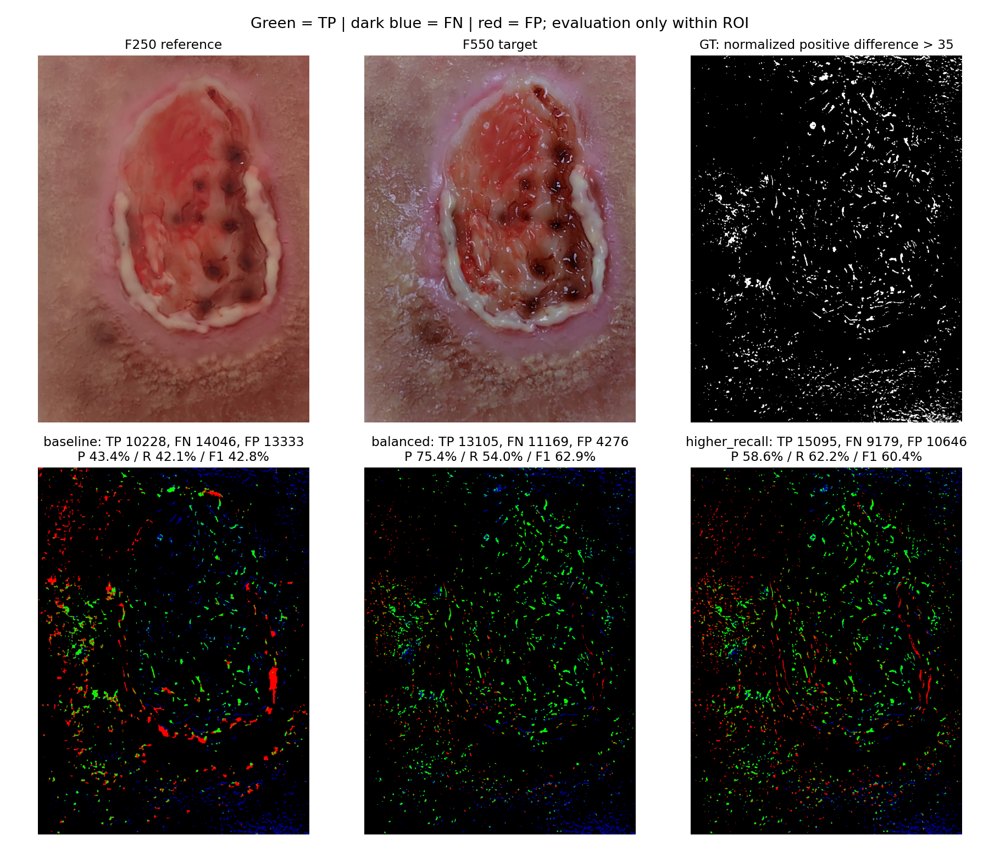

# Legacy 反光參數試驗：F250 / F550

影片：`D:\Lightglue\2026_1103_ZebraCamera_02video\1105\GigaImage_FailedVideo_High_20261105_150713.mp4`

條件：index 從 0 開始，ROI x=[650,1300)、y=[50,930)，面積 572,000 pixels。各幀在 ROI 內獨立 min-max normalize，單向差異 max(gray550-gray250,0)>35。Robust 校正 OFF，無幾何對齊。GT 正例 24,274 pixels。Legacy 必須先對完整影像偵測，再在 ROI 評分；不能先裁圖跑偵測，否則動態門檻、背景及形態學邊界會不同。

基準為測試當下主程式 SPATIAL_BLOCK_CONFIG，不代表未保存的 UI 調整。共 190 組不同設定，採單項對照、固定亂數種子的組合搜尋與最佳候選鄰域微調；非完整窮舉。

|設定|TP|FN|FP|Precision|Recall|F1|
|---|---:|---:|---:|---:|---:|---:|
|baseline|10,228|14,046|13,333|43.41%|42.14%|42.76%|
|balanced|13,105|11,169|4,276|75.40%|53.99%|62.92%|
|higher_recall|15,095|9,179|10,646|58.64%|62.19%|60.36%|

## 優先試 balanced：相對基準要改的參數

|參數|基準|balanced|
|---|---:|---:|
|`local_hot_percentile`|90.0|80.0|
|`v_min`|120.0|140.0|
|`local_hot_min`|35.0|15.0|
|`gray_min`|120.0|80.0|
|`gray_below_v`|10.0|50.0|
|`s_max`|50.0|120|
|`whiteness_max`|30.0|45|
|`background_sigma`|9.0|5.0|
|`prominence_min`|10.0|20.0|
|`close_kernel_px`|5|1|

其餘參數維持基準，完整設定見 recommendations.json。enable_prominence_gate=True、prominence_mad_multiplier=2、open_kernel_px=1、dilate_px=0。

較高召回方案 higher_recall：從 balanced 將 gray_min 改為 100、prominence_min 改為 15，其餘相同。

原始 14,046 個 FN 中，13,942 個未通過候選門檻，104 個在 gate 被排除。單獨關閉 gate：TP=10,348，FP=21,076。單獨 dilate_px=1：TP=13,817，FP=35,525。因此本例不建議靠關閉 gate 或全域膨脹解決。

本例組合是放寬帶色亮點與局部亮點的候選條件，同時用較嚴的 prominence 下限與較小 closing 減少 FP。這是組合結果，不代表每個參數單獨調整都會改善。

限制：搜尋與評估使用同一組影格／ROI，有對該案例過度調整的可能；差異 mask 是 proxy GT，包含照明、影像紋理或位移差異，不等同人工標註真值。需用其他影格或人工確認 mask 做獨立驗證。

## 重現

在 D:\Lightglue\lg_env 執行：
```powershell
.\Scripts\python.exe experiments/specular_250_550_20261105/verify_saved.py
```

verify_saved.py 使用保存的設定與條件，不讀取後續修改的主程式預設值。偵測算法與差異計算程式若後續改變，結果仍可能不同。

